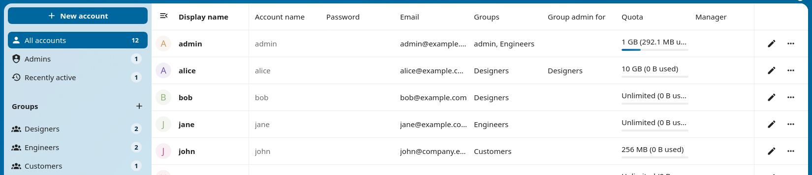
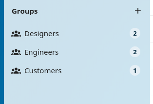
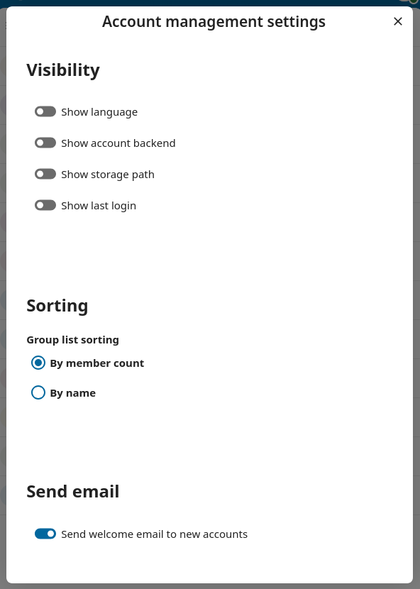
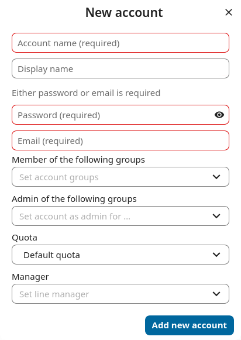
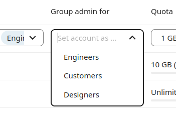
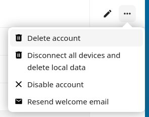

=================================
Managing user accounts and groups
=================================

On the Accounts management page of your Nextcloud Web UI you can:

* Create new user accounts
* View all accounts and filter accounts by group memberships
* Change passwords
* Add and edit account display names
* View and set account quotas
* Add and edit account email addresses
* Send welcome emails to new accounts
* See what groups accounts belong to and modify memberships
* Delegate administration of specific groups
* Disable and re-enable accounts
* Delete accounts
* See account data storage locations
* Specify an account holder's organizational manager (used by the address book and org chart generator)
* Wipe data from and disconnect an account's associated devices

The default view displays basic information about your configured accounts.

The group filters on the left sidebar let you quickly filter accounts by their
group memberships and create new groups.

.. note:: Account counts for certain groups, such as "All accounts," may not be
   visible when using certain backends such as LDAP/AD/SAML.

Click the gear icon on the lower left sidebar to set a default storage quota,
and to display additional fields: **Show storage location, Show last log in,
Show user backend, Send email to new accounts,** and **Show email address**.

Accounts have the following properties:

*Account name*
  The account’s unique identifier within this Nextcloud instance, also called the
  user ID or UID. Nextcloud uses it to associate data and settings with the account.
  It is not meant to change after the account is created. Use it when a command or
  API asks for the user ID.

  For an account in Nextcloud's local database, the account name or primary
  email address can be used to sign in. With an external backend, the accepted
  login name depends on the backend and its configuration and may differ from
  the Nextcloud user ID. See :doc:`user_auth_ldap` for an example.

*Display name*
  The name shown in the web interface, on shares, and in emails. It need not be
  unique. If no display name is set, Nextcloud shows the account name instead.
  Whether you can edit it depends on the user backend.

*Password*
  The admin sets the new account's initial password. Both the user and the admin can
  change the account's password at any time.

*Email*
  The email address configured for the account on the Accounts page.
  Nextcloud can send a welcome email to this address when enabled.
  Changing this address does not change the account's user ID.

  For accounts in Nextcloud's local database, this address can also be used
  to sign in. Other email addresses on the user's profile are not used for
  local sign-in. For accounts managed by an external backend, whether users
  can sign in with an email address depends on the backend's configuration.

  Email addresses need not be unique across accounts. If multiple accounts
  share an address, use the account name (user ID) to sign in or, when
  Nextcloud handles password resets, to request a reset for a specific account.

*Groups*
  You may create groups and assign group memberships to accounts. By default, new
  accounts are not assigned to any groups.

*Group Admin*
  Group admins are granted administrative privileges for specific groups and
  can create and remove users from their groups. They can modify properties such
  as display name, password, email, and quota, subject to backend restrictions.
  Group admins are not allowed to add existing accounts to their groups.

*Quota*
  The maximum file-based storage space assigned to each account. Any account that
  exceeds the quota cannot upload or sync further data. External storage consumption
  can optionally be included in account quotas.

*Manager*
  Every account can have one organizational manager. The manager property goes into
  the system address book card of the user and is used for the Contacts app's
  organization chart, for example. Setting a manager does **not** change any
  authorization level of the user or their manager.

Creating a new account
----------------------

To create a account for a user:

.. todo:: The opt-in core app setting newUser.generateUserID, off by default,
          disables the account name field.

* Enter an **Account name** to set the user ID for the new account.
* Enter an initial **Password**, or provide an email address to let the user
  set one.
* Optionally, enter a **Display name** and assign group memberships.
* Click the **Add new account** button

Account names you enter may contain letters (``a-z``, ``A-Z``), numbers
(``0-9``), dashes (``-``), underscores (``_``), periods (``.``), spaces, at
signs (``@``), and apostrophes (``'``).

If **Send email to new account** is toggled on in the *Account management
settings* (the lower left sidebar), you may also enter the new account's primary
email address, and Nextcloud will automatically send them a notification with
their new login information.

When utilizing the **Send email to new account** functionality, you can leave
the **Password** field empty. The user will receive an activation link in the
new account email to use to set their own password.

.. _reset-user-password:

Resetting a user's password
---------------------------

You cannot recover a user's account password, but you can set a new one:

* Hover your cursor over the account's row in the account list
* Click on the account's Edit icon (the **pencil** icon)
* Enter the account's new password in the **Password** field, and then provide
  the user with their account's new password.

If passwords resets from Nextcloud are disabled or not supported by the in-use
user backend, see :doc:`reset_user_password` for configuring an external reset
link.

If you have server-side encryption enabled, there are special considerations for
user password resets. Please see
:doc:`../configuration_files/encryption_configuration`.

Renaming a user
---------------

You can change an account's **Display name** if the user backend permits it.
This does not change the Nextcloud Account name (user ID) or the login name(s)
the backend accepts.

To set or change an account's display name:

* Hover your cursor over the account's row in the account list
* Click on the account's Edit icon (the **pencil** icon)
* Enter the account's new display name in the **Display name** field.

Granting administrator privileges to an account
-----------------------------------------------

Nextcloud has two types of administrators: **Super Administrators** and **Group
Administrators**. Group administrators have the rights to create, edit, and
delete accounts in their assigned groups. Group administrators cannot access
system settings or add or modify accounts in groups for which they are not **Group
Administrators**. Use the dropdown menus in the **Admin of the following groups**
field to assign group admin privileges.

**Super Administrators** have full rights on your Nextcloud server and can
access and modify all settings. To assign the **Super Administrators** role to
an account, add them to the built-in ``admin`` group.

Managing groups
---------------

You can assign new accounts to groups when you create them and create new groups
when you create new accounts.

You may also adjust group membership by editing an account and adjusting the contents
of the "Member of the following groups" field. To add new groups, click the plus sign
in the left pane (adjacent to the **Groups** section under Accounts).

The group display name is the label you see in Nextcloud. Use the group ID (GID)
when a command or API asks for it.

New group members immediately have access to resources that belong to their new
groups.

Setting storage quotas
----------------------

Click the gear icon on the lower left pane to set a default storage quota. This is
automatically applied to new accounts. You may assign a different quota to any account
by selecting from the **Quota** dropdown, selecting either a preset value or
entering a custom value. When you create custom quotas, use the standard
abbreviations for your storage values, such as ``500 MB``, ``5 GB``, ``5 TB``, and so on.

Users can check their used and available space on their Personal pages. Only files that
originate with a user count against their quota, and not files shared with them that
originate from other accounts. For example, if you upload files to a different user's
share, those files count against your quota. If you re-share a file that another user
shared with you, that file does not count against your quota, but the originating
account's.

External Storage
^^^^^^^^^^^^^^^^

External storage is not counted against users' quotas by default, but inclusion can be
toggled on. This is still experimental and may not work as expected. The default is to
not count external storage as part of account storage quotas. If you prefer to include it,
then change the default ``false`` to ``true`` in ``config.php``::

   'quota_include_external_storage' => false,

.. note:: If an external storage is defined as root, the quota will not
   be calculable and will be **ignored**.

Metadata
^^^^^^^^

Metadata (such as thumbnails, temporary files, and encryption keys) is not counted
against account quotas.

.. note:: Encrypted files may be larger than unencrypted files; the unencrypted size
          is calculated against the account's quota.

Deleted files
^^^^^^^^^^^^^

Deleted files that are still in the trash bin do not count against quotas. The
trash bin is set at 50% of quota. Deleted file aging is set at 30 days. When
deleted files exceed 50% of quota, the oldest files are removed until the
total is below 50%.

File versions
^^^^^^^^^^^^^

When version control is enabled, older file versions are not counted
against quotas.

Shared folders
^^^^^^^^^^^^^^

When a user creates a public share via URL and allows uploads, any uploaded
files count against that user's quota.

Disabled accounts
-----------------

Sometimes you may want to disable an account without permanently deleting their
settings and files. The account can be activated again at any time, without data loss.

Hover your cursor over their account's row on the Accounts page and click "..." menu
icon at the far right. After clicking on it, you will see the **Disable account** option.

The user will no longer be able to access their Nextcloud account until you re-enable
it. Also, all external shares, via public link or email, will no longer be accessible.
Internal shares, however, will continue to work.

If you wish for internal shares to be disabled as well when an account is disabled,
toggle the following configuration option::

 occ config:app:set files_sharing hide_disabled_user_shares --value yes

You will find all disabled accounts in the **disabled** section on the left pane.
Enabling accounts is as easy as disabling them. Just click on the "..." menu, and
select **Enable account**.

Deleting accounts
-----------------

Deleting an account is easy: hover your cursor over the account's row on the **Accounts**
and click the "..." menu icon at the far right. After clicking on it, you will see the
**Delete account** option. Clicking on it deletes the account and all their data
immediately.

.. tip:: You'll see an undo button at the top of the page, which remains for a few seconds.
         When the undo button is gone, you cannot recover the deleted account.

All of the files owned by the account are deleted as well, including all files they
have shared. If you need to preserve the user's files and shares, you must first
download them from your Nextcloud Files page, which compresses them into a zip
file, or use a sync client to copy them to your local computer. See
:doc:`../configuration_files/file_sharing_configuration` to learn how to create
persistent file shares that survive user deletions.

Disabling the "Your email address [...] was changed" email
----------------------------------------------------------

If an email address of an account is changed by an admin, then it triggers an email
to the user that states "Your email address on [URL] was changed by an
administrator.". In some cases this should not be triggered, because it was a
normal maintenance change. To disable this specific email the appconfig option
``disable_email.email_address_changed_by_admin`` can be set to ``yes``::

    occ config:app:set settings disable_activity.email_address_changed_by_admin --value yes

To disable this behaviour change it to any other value or delete the app config::

    occ config:app:delete settings disable_activity.email_address_changed_by_admin

