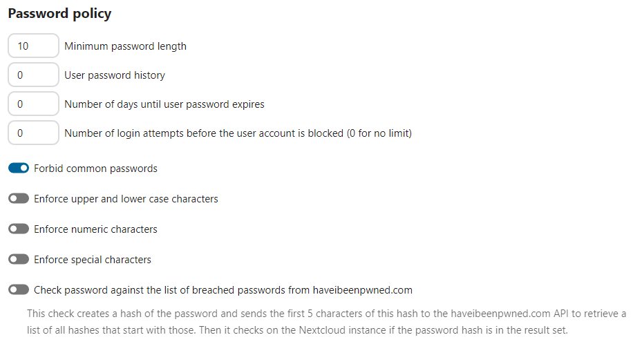

===============
Password policy
===============

Configure password policies in the security section of the administration
settings. The account password policy also applies to share passwords by
default. You can also configure a separate policy for share passwords.

Customizable password policies include:

* Minimum password length (default: 10 characters)
* Blocking common passwords (such as ``password`` or ``login``)
* Requiring uppercase and lowercase characters
* Requiring numeric characters
* Requiring special characters (such as ``!`` or ``:``)
* Checking passwords against the breached-password list operated by HaveIBeenPwned.com (HIBP) 

.. note:: For the breached-password check, Nextcloud hashes the password locally,
          then sends only the first five characters of the hash to the HIBP API. If the API is
          unreachable, the check is skipped.

Account password-specific policies include:

* Password history size (to prevent reuse of previous passwords)
* Maximum consecutive failed login attempts; reaching the limit disables the
  account until an administrator re-enables it. Set to 0 for no limit.
* Password expiration period (in days) for supported local accounts

.. warning::
   Password expiration is considered a security risk by several security agencies.

