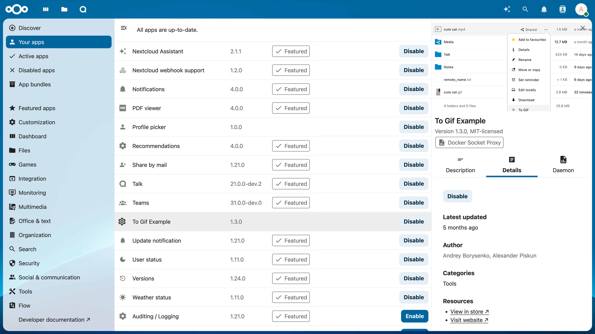

========================
AppAPI and External Apps
========================

.. _ai-app_api:

Previously, Nextcloud only supported applications written in the PHP programming language.
In order to support a wider range of use cases,
an ecosystem for **ExApps** (short for "External Apps") was introduced, allowing for the installation of apps as Docker containers.

Most of our :doc:`Artificial Intelligence <../ai/index>` (AI) apps are developed as ExApps and thus may require some preparation of your Nextcloud instance before you can install them.

.. tip::
    AppAPI and ExApps are optional functionality. If you do not use any non-PHP applications then you may safely disable AppAPI by navigating to the Apps management page in your Nextcloud instance, going to "Your Apps" and clicking the "Disable" button next to AppAPI.

Installing AppAPI
-----------------

All ExApps require the `AppAPI <https://apps.nextcloud.com/apps/app_api>`_ Nextcloud app as a dependency.
As of Nextcloud version 30.0.1, AppAPI is automatically installed by default.
If AppAPI is not installed, you can still install it by simply navigating to the Apps management page in your Nextcloud instance and search for AppAPI from the Tools category.

Setup deploy daemon
-------------------

A Deploy Daemon is the way for Nextcloud to install, communicate with, and control ExApps.

.. note::
    If you are using Nextcloud AIO with the "HaRP" container enabled, a Deploy Daemon will be automatically created and configured to work out-of-the-box.
    Otherwise, follow the steps below to set up a Deploy Daemon from the AppAPI admin settings.

.. tip::
    After registering a Deploy Daemon, use the **Test Deploy** action to verify it is reachable and working.
    In the list of Deploy Daemons, click the `...` (three‑dots) menu beside the daemon you want to verify and choose Test Deploy.
    For details on what this check does and how to interpret the results, see :ref:`Test Deploy <test_deploy>`.

.. _ai-app_api_harp:

HaRP
~~~~

HaRP is the deploy daemon for ExApps in Docker. It requires changes in the proxy of your Nextcloud instance.

1. Setup a Docker container called `HaRP <https://github.com/nextcloud/HaRP?tab=readme-ov-file#how-to-install-it>`_ that proxies access to Docker and to the ExApps for your Nextcloud instance. Be mindful of changing the values of ``HP_SHARED_KEY`` and ``NC_INSTANCE_URL``, and :ref:`generate your own shared key <ai-app_api_harp-shared-key>` instead of using the example value.
2. Go to AppAPI admin settings.
3. Click on the "Register Daemon" button.
4. | A filled form should appear. This default configuration ``HaRP Proxy (Host)`` should work for most setups. For Nextcloud AIO, use ``HaRP All-in-One``.
   | If you are using Nextcloud in a custom docker network and would want the HaRP container to be limited to it, use the ``HaRP Proxy (Docker)`` option to have the fields pre-filled with the common options or change them manually.
   | Here, you should ensure the HaRP container itself is launched with the same network as your Nextcloud instance optionally with no ports exposed to the host in step 1, and the same docker network is mentioned in the ``Network`` field in the deploy config.
5. Ensure the same shared key is used in the HaRP container and in the AppAPI settings.
6. Click "Check connection" to verify that the configuration is correct.
7. Click "Register" to save the Deploy Daemon configuration.
8. Set up a location redirect in your Nextcloud's main proxy configuration to redirect requests to the HaRP container. Some examples for popular reverse proxies can be found in `Configuring Your Reverse Proxy <https://github.com/nextcloud/harp?tab=readme-ov-file#configuring-your-reverse-proxy>`_ in the HaRP readme.
9. Test the whole setup with "Test deploy" in the 3-dots menu of the Deploy Daemon.

This is suitable for local setups where the Nextcloud server and the ExApps are on the same machine or in the same docker network.
The ExApps in this configuration or the ExApp server need not expose any ExApp related port (23000-23999) necessarily to the host, nor do they need to be reachable from the host. They should be able to reach the HaRP container at the FRP port and the Nextcloud instance.
For different/remote setups, see deployment configuration examples :doc:`here <./DeployConfigurations>`.

.. _ai-app_api_dsp:

Moving ExApps from Docker Socket Proxy to HaRP
~~~~~~~~~~~~~~~~~~~~~~~~~~~~~~~~~~~~~~~~~~~~~~

AppAPI no longer supports ``docker-install`` deploy daemons without HaRP: Docker Socket Proxy (DSP) daemons and
daemons on a local Docker socket. Registering one is refused. Existing ones stay registered and Nextcloud still reaches
their ExApps, but AppAPI no longer manages these ExApps:

* Installing or updating an ExApp, "Test deploy" and downloading logs fail with a "no longer supported" error.
* Enabling an ExApp only checks its heartbeat and does not start its container.
* Disabling an ExApp leaves its container running.
* Removing an ExApp keeps its container and data volume.
* These daemons can only be deleted: editing them and their Docker registry mappings is refused.

The **AppAPI Docker Socket Proxy daemons** setup check lists these daemons, and the **AppAPI deploy daemon** setup check
reports a default daemon without HaRP.

To move the ExApps of such a daemon to HaRP:

1. Install :ref:`HaRP <ai-app_api_harp>` on the Docker host of the old daemon and register a HaRP deploy daemon.
2. Check it with "Test deploy" in the 3-dots menu of the HaRP daemon.
3. Set the HaRP daemon as the default.
4. Remove each ExApp of the old daemon and keep its data: run ``occ app_api:app:unregister <appid>`` without
   ``--rm-data``.
5. Install the ExApps again. They are installed on the HaRP daemon, which replaces the ``nc_app_<appid>`` container and
   reuses the ``nc_app_<appid>_data`` volume.
6. Delete the old daemon in the AppAPI admin settings, then remove its DSP container, if any.

An ExApp that you do not install again keeps its old container running. Remove that container by hand.

Installing ExApps
-----------------

You can now install ExApps from the Nextcloud App Store by clicking "Install" on the respective app in the Apps page.
If successful, the ExApp will be displayed under the "Your apps" list.

FAQ
---

* I have two graphics cards (e.g. NVIDIA RTX 3060) with 8 GB of VRAM each. How can I run something which does not fit into one graphics card?
    * Distributing models across multiple GPUs is currently not supported. You will need a GPU that fits all of the model you are trying to use.
* I have a graphics card that does not support CUDA - can I use it and how?
    * No, our AI apps require GPUs with CUDA support to function at this time.
* What is the minimum VRAM size requirement for the GPU if I want to install multiple apps?
    * When running multiple ExApps on the same GPU, the GPU must hold the largest model amongst the apps you install.
* Is it possible to add more graphics cards for my instance to enable parallel requests or to speed up one request?
    * Parallel processing of AI workloads for the same app with multiple GPUs is currently not supported.
* Can I use the CPU and GPU in parallel for AI processing?
    * No, you can only process AI workloads on either the CPU or GPU for one app. For different apps, you can decide whether to run them on CPU or GPU.
* Can I run the same ex app container once for two different nextcloud instances at the same time?
   * No, each ExApp container can only be used for one Nextcloud instance at a time. You would need to run separate containers and even separate docker hosts for each Nextcloud instance.

How HaRP works
--------------

| `FRP <https://github.com/fatedier/frp>`_ is used to create a tunnel between the ExApp and the HaRP container so there is no need for the ExApp containers to expose any ports to the host or to be reachable from the Nextcloud server.
| The Nextcloud server can reach the ExApp containers through the HaRP container.

HaRP proxies requests coming from the Web interface or an API to the ExApp container without going through the Nextcloud server, saving resources, improving performance and supporting additional protocols like WebSockets.

Frontend requests:

.. mermaid::

    graph LR;
        subgraph Browser
            A[Frontend]
        end

        B[Proxy]

        subgraph Services behind the proxy
            C[HaRP]
            D[ExApp]
            E[Nextcloud Server / AppAPI]
        end

        B --All other usual requests--> E
        A --> B
        B --Direct request to an ExApp--> C --Converted to ExApp auth--> D
        C --User auth validation--> E
