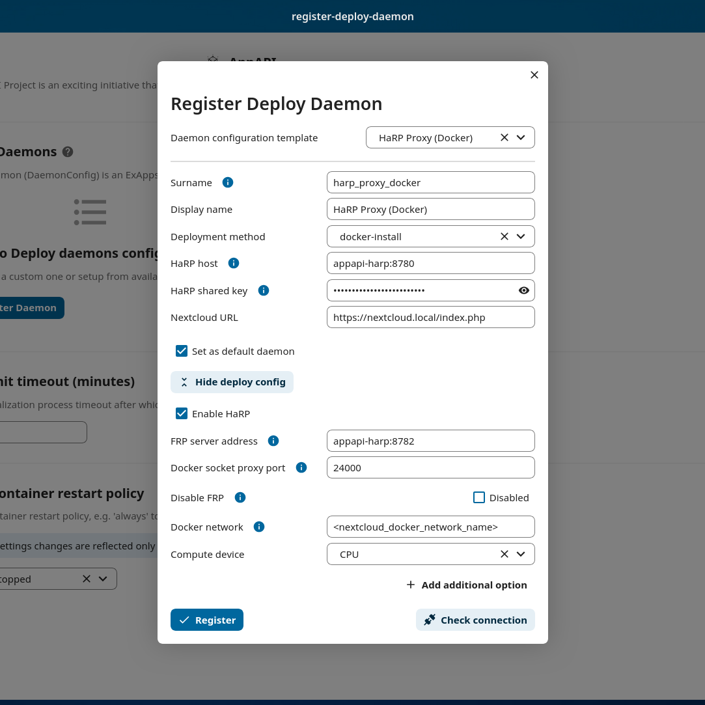

.. _deploy-configs:

Deployment configurations
=========================

Docker deployments use the :ref:`Docker Deploy Daemon (HaRP) <ai-app_api_ddd-harp>`.

Docker Deploy Daemon
--------------------

Orchestrates the deployment of applications as Docker containers.

.. warning::

    | The administrator is responsible for the security actions taken to configure the Docker daemon connected to the Nextcloud instance.
    | These schemes are only examples of possible configurations.

    | For Docker Deploy Daemon (HaRP), `AppAPI HaRP <https://github.com/nextcloud/harp>`_ is required.

There are several Docker Daemon Deploy configurations (example schemes):

    * Nextcloud and Docker on the **same host**
    * Nextcloud on the host and Docker on a **remote** host
    * Nextcloud and **ExApps** in the **same Docker network**
    * Nextcloud in AIO Docker and **ExApps** in the **same Docker network**

.. _ai-app_api_ddd-harp:

Docker Deploy Daemon (HaRP)
---------------------------

With HaRP, the ExApps initiate the connection for tunneling to the Nextcloud instance and the HaRP container so there is no need to expose any ports or open any firewall rules.

A little introduction to the default ports of the HaRP container is given below. More about it can be found in the `HaRP's readme <https://github.com/nextcloud/harp?tab=readme-ov-file#environment-variables>`_.

* Port ``8780`` is the HTTP communication port used where Nextcloud connects to the HaRP container.
* Port ``8781`` is the HTTPS communication port when setup.
* Port ``8782`` is the FRP tunnel port used by ExApps to connect to the HaRP container.

In any of the cases, the following connections should succeed:

* Nextcloud -> HaRP container (on port 8780/8781)
* HaRP container -> Nextcloud (through proxy or directly as the NC_INSTANCE_URL env var dictates)
* ExApp -> HaRP container (on port 8782)
* ExApp -> Nextcloud (through proxy or directly as the ``Nextcloud URL`` in the daemon config dictates)

.. _ai-app_api_harp-shared-key:

.. warning::

    The examples below use ``some_very_secure_password`` as the HaRP shared key. This is only a placeholder: generate
    your own random key for every installation, for example with ``openssl rand -hex 32``.

    Use the same key for ``HP_SHARED_KEY`` of the HaRP container, the **HaRP shared key** field of the deploy daemon
    and, for a remote Docker host, ``metadatas.token`` in ``frpc.toml``. Anyone who knows the key can talk to HaRP the
    way Nextcloud does, including managing ExApp containers on the Docker host, so keep it secret.

.. _ai-app_api_nc-harp-baremetal:

Nextcloud and Docker on the same host - with Nextcloud bare metal
^^^^^^^^^^^^^^^^^^^^^^^^^^^^^^^^^^^^^^^^^^^^^^^^^^^^^^^^^^^^^^^^^

The simplest configuration is when Nextcloud is installed on the host and docker is on the same host and applications are deployed to it.

Create a HaRP container with either ``--network host`` option or expose the ports ``8780`` and ``8782`` to the host.

.. code-block:: bash

  docker run \
    -e HP_SHARED_KEY="some_very_secure_password" \
    -e NC_INSTANCE_URL="https://127.0.0.1:8080" \
    -v /var/run/docker.sock:/var/run/docker.sock \
    -v `pwd`/certs:/certs \
    --name appapi-harp -h appapi-harp \
    --restart unless-stopped \
    -p 8780:8780 \
    -p 8782:8782 \
    -d ghcr.io/nextcloud/nextcloud-appapi-harp:release

Go to AppAPI admin settings and register a ``HaRP Proxy (Host)`` daemon.

Finally, test the whole setup with "Test deploy" in the 3-dots menu of the deploy daemon.

Nextcloud and Docker on the same host - with Nextcloud in Docker
^^^^^^^^^^^^^^^^^^^^^^^^^^^^^^^^^^^^^^^^^^^^^^^^^^^^^^^^^^^^^^^^

When Nextcloud is installed in Docker, the HaRP container can be created in the same docker network as the Nextcloud instance.

Create a HaRP container with ``--network <nextcloud_docker_network_name>`` option, where ``<nextcloud_docker_network_name>`` is the name of the Docker network in which Nextcloud is accessible.

.. code-block:: bash

  docker run \
    -e HP_SHARED_KEY="some_very_secure_password" \
    -e NC_INSTANCE_URL="https://nextcloud.tld" \
    -v /var/run/docker.sock:/var/run/docker.sock \
    -v `pwd`/certs:/certs \
    --name appapi-harp -h appapi-harp \
    --restart unless-stopped \
    --net <nextcloud_docker_network_name> \
    -d ghcr.io/nextcloud/nextcloud-appapi-harp:release

Go to AppAPI admin settings and register a ``HaRP Proxy (Docker)`` daemon. Take note of the ``<nextcloud_docker_network_name>`` value in the ``Docker network`` field.

Finally, test the whole setup with "Test deploy" in the 3-dots menu of the deploy daemon.

Docker on a remote host - with HaRP container on the local host
^^^^^^^^^^^^^^^^^^^^^^^^^^^^^^^^^^^^^^^^^^^^^^^^^^^^^^^^^^^^^^^

This configuration is suited for deployments that want to offload the heavy lifting of the ExApps to a remote host, especially when using GPUs as compute devices. There can be multiple deploy daemons that can be used to deploy ExApps on different remote hosts for different compute capabilities.
Here the HaRP container is deployed on the local host and the remote host tunnels the remote host's docker socket to the local host over the `FRP <https://github.com/fatedier/frp>`_ secure tunnel. The ExApps are deployed on the remote host.
A setup with the HaRP container itself on the remote is not supported.

1. Create a HaRP container in the local host following :ref:`the above examples <ai-app_api_nc-harp-baremetal>` but without the docker socket mount.

  .. code-block:: bash

    docker run \
      -e HP_SHARED_KEY="some_very_secure_password" \
      -e NC_INSTANCE_URL="https://127.0.0.1:8080" \
      -v `pwd`/certs:/certs \
      --name appapi-harp -h appapi-harp \
      --restart unless-stopped \
      -p 8780:8780 \
      -p 8782:8782 \
      -d ghcr.io/nextcloud/nextcloud-appapi-harp:release

2. Create a matching deploy daemon with ``Docker socket proxy port`` set to ``24001``.

  .. image:: ./img/harp_remote_24001.png
     :alt: AppAPI deploy daemon configuration with Docker socket proxy port set to 24001

3. The FRP generated client certificates should be present in the ``certs`` folder locally. Copy the files ``client.crt``, ``client.key`` and ``ca.crt`` inside the ``certs`` folder to the remote host.
4. Create a folder structure on the remote host: ``mkdir -p certs/frp`` and copy the files ``client.crt``, ``client.key`` and ``ca.crt`` to the ``certs/frp`` folder.
5. Create a new file ``frpc.toml`` with the following contents.

    .. code-block:: toml

        # frpc.toml
        serverAddr = "your.harp.server.address"          # Replace with your HP_FRP_ADDRESS host
        serverPort = 8782                                # Default port for FRP or the port your reverse proxy listens on
        loginFailExit = false                            # If the FRP (HaRP) server is unavailable, continue trying to log in.

        transport.tls.certFile = "certs/frp/client.crt"
        transport.tls.keyFile = "certs/frp/client.key"
        transport.tls.trustedCaFile = "certs/frp/ca.crt"
        transport.tls.serverName = "harp.nc"             # DO NOT CHANGE THIS VALUE

        metadatas.token = "some_very_secure_password"    # HP_SHARED_KEY in quotes

        [[proxies]]
        remotePort = 24001                               # Unique remotePort for each Docker Engine (range: 24001-24099)
        name = "deploy-daemon-1"                         # Unique name for each Docker Engine
        type = "tcp"
        [proxies.plugin]
        type = "unix_domain_socket"
        unixPath = "/var/run/docker.sock"

   | Make sure to replace the ``your.harp.server.address`` with the actual address of the local host where the HaRP container is running.
   | You might want to open the port ``8782`` on the local host firewall to allow the remote host to connect to it,
   | or use a reverse proxy to forward the requests to the HaRP container. An example with nginx is given below. Feel free to adjust the port you want to listen on. The FRP client will connect to this port exposed port.
   | With the reverse proxy config below, the whole setup would only need the main Nextcloud proxy to be exposed and reachable from the outside world, simplifying the network setup.

    .. code-block:: nginx

        stream {
            server {
                listen 8782;  # Replace with the port you want to listen on
                proxy_pass 127.0.0.1:8782;
                proxy_protocol off;
                proxy_connect_timeout 10s;
                proxy_timeout 300s;
            }
        }

6. Download a release of the FRP client from `the official releases <https://github.com/fatedier/frp/releases/latest>`_ or `our snapshot from here <https://github.com/nextcloud/HaRP/tree/main/exapps_dev>`_.
7. Extract and copy the ``frpc`` binary to an appropriate location on the remote host, e.g. ``/usr/local/bin``.
8. Make it executable: ``chmod +x /usr/local/bin/frpc``.
9. Start the FRP client with the command: ``frpc -c /path/to/frpc.toml``.
10. Finally, test the whole setup with "Test deploy" in the 3-dots menu of the deploy daemon.

Docker / Reverse Proxy / Nextcloud on 3 independent hosts - with HaRP container
^^^^^^^^^^^^^^^^^^^^^^^^^^^^^^^^^^^^^^^^^^^^^^^^^^^^^^^^^^^^^^^^^^^^^^^^^^^^^^^

This is the related infrastructure

.. mermaid::

    stateDiagram-v2
        classDef docker fill: #1f97ee, color: white, font-size: 34px, stroke: #364c53, stroke-width: 1px, background: url(https://raw.githubusercontent.com/nextcloud/documentation/master/admin_manual/exapps_management/img/docker.png) no-repeat center center / contain
        classDef nextcloud fill: #006aa3, color: white, font-size: 34px, stroke: #045987, stroke-width: 1px, background: url(https://raw.githubusercontent.com/nextcloud/documentation/master/admin_manual/exapps_management/img/nextcloud.svg) no-repeat center center / contain
        classDef python fill: #1e415f, color: white, stroke: #364c53, stroke-width: 1px

        Direction LR

            Host1 --> Host2 : by port
            Host3 --> Host1 : by port
            Host3 --> Host2 : by port

        state Host1 {
            Nextcloud
        }

        state Host2 {
            [*] --> HaRP : by port
            Daemon --> Containers

            state Containers {
                [*] --> HaRP : /var/run/docker.sock
                HaRP --> ExApp1
                HaRP --> ExApp2
                HaRP --> ExApp3
            }
        }

        state Host3 {
            Apache Reverse Proxy
        }

        class Nextcloud nextcloud
        class Daemon docker
        class ExApp1 python
        class ExApp2 python
        class ExApp3 python

Please see below the steps I follow
All of the following steps are based on a Almalinux Distro.
Please customize for your distribution.

1. On the Host2 Docker

1.1. Creation of Cert folder (if necessary)

  .. code-block:: bash

    mkdir -p /some/path/certs

1.2. Open ports

  .. code-block:: bash

    firewall-cmd --permanent --zone=public --add-port=8780/tcp
    firewall-cmd --permanent --zone=public --add-port=8782/tcp
    firewall-cmd --reload

1.3. Deploy of the HaRP Container

  .. code-block:: bash

    docker run \
      -e HP_SHARED_KEY="some_very_secure_password" \
      -e NC_INSTANCE_URL="https://cloud.acme.com" \
      -e HP_TRUSTED_PROXY_IPS="192.168.0.0/24" \
      -v /var/run/docker.sock:/var/run/docker.sock \
      -v /some/path/certs:/certs \
      -p 8780:8780 \
      -p 8782:8782 \
      --name appapi-harp -h appapi-harp \
      --restart unless-stopped \
      -d ghcr.io/nextcloud/nextcloud-appapi-harp:release

  Replace ``192.168.0.0/24`` with the IP address or subnet of your reverse proxy (Host3).

2. On the Host3 Apache Reverse Proxy - Reverse proxy redirections

On the virtual Host "cloud.acme.com" of the apache conf file
Add the following lines (before the existing configuration)

    .. code-block:: apache

        #  AppAPI Configuration
        ProxyPass /exapps/ http://<IP_host2_docker>:8780/exapps/
        ProxyPassReverse /exapps/ http://<IP_host2_docker>:8780/exapps/

3. On the Nextcloud Web Interface - Daemon Register

Add the following configuration :

* Daemon configuration template : ``HaRP Proxy (HOST)``
* Surname : ``appapi-harp``
* Display name : ``appapi-harp``
* Deployment method : ``docker-install``
* HaRP host : ``<IP_host2_docker>:8780``
* HaRP shared key : ``some_very_secure_password``
* Nextcloud URL : ``https://cloud.acme.com``
* FRP server address : ``<IP_host2_docker>:8782``
* Docker network : ``bridge``

Finally, test the whole setup with “Test deploy” in the 3-dots menu of the deploy daemon.

4. Additional tests from the network of your hosts

.. note::

    The ``docker-engine-port`` header tells HaRP which internal virtual port to route to the Docker engine.
    When HaRP has the Docker socket mounted directly (as in this setup), it uses ``24000`` as the default
    virtual port for that local socket. This value does not require any additional firewall or port configuration.

  .. code-block:: bash

    curl -fsS \
      -H "harp-shared-key: some_very_secure_password" \
      -H "docker-engine-port: 24000" \
      http://<IP_host2_docker>:8780/exapps/app_api/v1.41/_ping

  .. code-block:: bash

    curl -fsS \
      -H "harp-shared-key: some_very_secure_password" \
      -H "docker-engine-port: 24000" \
      https://cloud.acme.com/exapps/app_api/v1.41/_ping

.. _nextcloud-in-docker-aio-all-in-one:

Nextcloud in Docker AIO (all-in-one)
^^^^^^^^^^^^^^^^^^^^^^^^^^^^^^^^^^^^

In the case of AppAPI in Docker AIO setup (installed in Nextcloud container).

.. note::

    AIO HaRP container must be enabled.

.. mermaid::

    stateDiagram-v2
        classDef docker fill: #1f97ee, color: white, font-size: 34px, stroke: #364c53, stroke-width: 1px, background: url(https://raw.githubusercontent.com/nextcloud/documentation/master/admin_manual/exapps_management/img/docker.png) no-repeat center center / contain
        classDef docker2 fill: #1f97ee, color: white, font-size: 20px, stroke: #364c53, stroke-width: 1px, background: url(https://raw.githubusercontent.com/nextcloud/documentation/master/admin_manual/exapps_management/img/docker.png) no-repeat center center / contain
        classDef nextcloud fill: #006aa3, color: white, font-size: 34px, stroke: #045987, stroke-width: 1px, background: url(https://raw.githubusercontent.com/nextcloud/documentation/master/admin_manual/exapps_management/img/nextcloud.svg) no-repeat center center / contain
        classDef python fill: #1e415f, color: white, stroke: #364c53, stroke-width: 1px

        Host

        state Host {
            Daemon --> Containers

            state Containers {
                [*] --> NextcloudAIOMasterContainer : /var/run/docker.sock
                [*] --> HaRP : /var/run/docker.sock
                NextcloudAIOMasterContainer --> Nextcloud
                AppAPI --> Nextcloud : installed in
                Nextcloud --> HaRP
                HaRP --> ExApp1
                HaRP --> ExApp2
                HaRP --> ExApp3
            }
        }

        class Nextcloud nextcloud
        class Daemon docker
        class Daemon2 docker2
        class ExApp1 python
        class ExApp2 python
        class ExApp3 python

AppAPI will automatically create the DaemonConfig for AIO HaRP and set it as the default,
in order to use it as an orchestrator to create ExApp containers.

.. note::

    The DaemonConfig is created only if it is not already registered.

Default AIO Deploy Daemon (HaRP)
********************************

Nextcloud AIO has a specifically created HaRP container to be used as the Deploy Daemon in AppAPI.
It has `fixed parameters <https://github.com/nextcloud/app_api/blob/main/lib/DeployActions/AIODockerActions.php>`_:

* Name: ``harp_aio``
* Display name: ``AIO HaRP``
* Accepts Deploy ID: ``docker-install``
* Protocol: ``http``
* Host: ``nextcloud-aio-harp:8780``
* HaRP shared key: ``HP_SHARED_KEY`` of the AIO HaRP container
* FRP tunnel: disabled, HaRP connects to the ExApps directly
* Compute device: ``CPU``
* Network: ``nextcloud-aio``
* Nextcloud URL (passed to ExApps): ``https://$NC_DOMAIN``

.. _exapp-container-log-rotation:

Container log rotation
----------------------

AppAPI deploys each ExApp as a container but does not set a logging configuration on it, so each ExApp container
uses the logging settings of the deploy daemon that runs it. If those logs have no size limit they are never
rotated and can grow until they fill the host disk. Configure rotation on the daemon, where it applies to every
container the daemon runs.

Docker
^^^^^^

Docker's default ``json-file`` driver sets no size limit. Add the following to the Docker daemon configuration file
(:file:`/etc/docker/daemon.json` on most Linux hosts) and restart the daemon:

.. code-block:: json

    {
        "log-driver": "json-file",
        "log-opts": {
            "max-size": "10m",
            "max-file": "3"
        }
    }

.. code-block:: bash

    sudo systemctl restart docker

Each container then keeps at most ``max-file`` log files of ``max-size`` each (here three files of 10 MB, so up to
30 MB per container). Adjust the values to suit your hosts.

.. note::

    A container keeps the logging configuration it was created with, and disabling and enabling an ExApp only stops
    and starts the existing container. Remove and install the affected ExApps again (or update them) so their
    containers are recreated with the new settings.

.. important::

    Keep the ``json-file`` or ``journald`` driver: AppAPI can only download container logs for these two drivers, so a
    different driver disables log downloads for ExApp containers.

If you deliberately use a different driver (``syslog``, ``fluentd``, and so on) to forward logs elsewhere, keep your
existing setup: rotation is then handled by that driver and the steps above do not apply.

Podman
^^^^^^

When the deploy daemon is Podman, set a global default in :file:`/etc/containers/containers.conf` (or the per-user
file) and re-deploy the affected ExApps:

.. code-block:: toml

    [containers]
    log_driver = "json-file"
    log_size_max = 10485760

Kubernetes
^^^^^^^^^^

For the Kubernetes deploy daemon, container log rotation is handled by the kubelet, not by AppAPI. Set
``containerLogMaxSize`` and ``containerLogMaxFiles`` in the kubelet configuration on each node and restart the kubelet
for the change to take effect (it loads its configuration only at startup); see the
`Kubernetes logging architecture <https://kubernetes.io/docs/concepts/cluster-administration/logging/>`_ documentation.

NC to ExApp Communication
-------------------------

Communications between Nextcloud and ExApps are done via the AppAPI.
For HaRP, the communication goes through the main Nextcloud proxy and the HaRP container.

Each type of DeployDaemon necessarily implements the ``resolveExAppUrl`` function.

It has the prototype:

.. code-block:: php

    public function resolveExAppUrl(
        string $appId, string $protocol, string $host, array $deployConfig, int $port, array &$auth
    ) {}

where:

* **protocol** is daemon protocol value
* **host** is daemon host value, *can be DNS:port or IP:PORT*.
* **port** is an integer with ExApp port
* **deployConfig** can be custom for each Daemon type
* **auth** is an optional array, with *Basic Authentication* data if needed to access ExApp

.. note::

    Applies only to daemons without HaRP.

    The optional additional parameter *OVERRIDE_APP_HOST* can be used to
    override the host that will be used for ExApp binding.

    It can be ``0.0.0.0`` in some specific configurations, when VPN is used
    or both Nextcloud instance and ExApps are one the same physical machine but different virtual environments.

    Also you can specify something like ``10.10.2.5`` and in this case ``ExApp`` will try to bind to that address and
    AppAPI will try to send request s directly to this address assuming that ExApp itself bound on it.

The simplest implementation is in the **Manual-Install** deploy type:

.. code-block:: php

    public function resolveExAppUrl(
        string $appId, string $protocol, string $host, array $deployConfig, int $port, array &$auth
    ): string {
        if (boolval($deployConfig['harp'] ?? false)) {
            $url = rtrim($deployConfig['nextcloud_url'], '/');
            if (str_ends_with($url, '/index.php')) {
                $url = substr($url, 0, -10);
            }
            return sprintf('%s/exapps/%s', $url, $appId);
        }

        $auth = [];
        if (isset($deployConfig['additional_options']['OVERRIDE_APP_HOST']) &&
            $deployConfig['additional_options']['OVERRIDE_APP_HOST'] !== ''
        ) {
            $wideNetworkAddresses = ['0.0.0.0', '127.0.0.1', '::', '::1'];
            if (!in_array($deployConfig['additional_options']['OVERRIDE_APP_HOST'], $wideNetworkAddresses)) {
                $host = $deployConfig['additional_options']['OVERRIDE_APP_HOST'];
            }
        }
        return sprintf('%s://%s:%s', $protocol, $host, $port);
    }

| Here we see that AppAPI sends requests to the **host**:**port** specified during daemon creation for manual-install without HaRP.
| But it exclusively uses the ``http(s)://nextcloud.example.tld/exapps/`` route for manual deployments using the HaRP proxy. ``http(s)://nextcloud.example.tld`` is the Nextcloud URL specified in the daemon config. Take care to configure the ``/exapps/`` route in your reverse proxy accordingly if your Nextcloud instance is on a subpath ``https://nextcloud.example.tld/nextcloud``. See `Configuring Your Reverse Proxy <https://github.com/nextcloud/harp?tab=readme-ov-file#configuring-your-reverse-proxy>`_ in the HaRP readme for examples.

The Docker and Kubernetes Deploy Daemons use HaRP, so their requests always go to the ``/exapps/`` route of the
Nextcloud URL.
