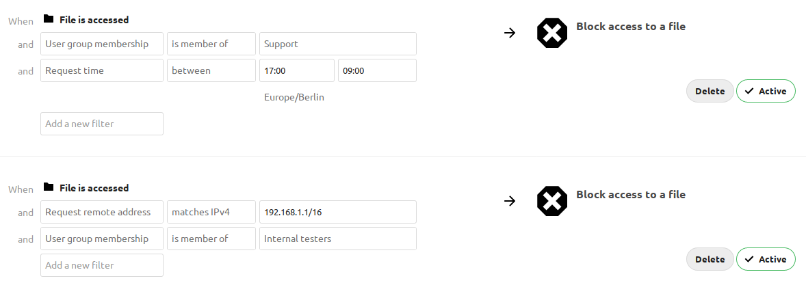
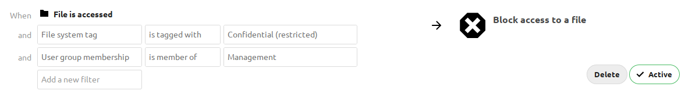
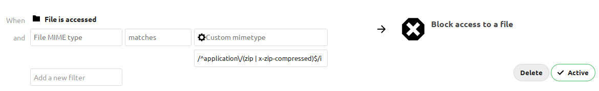

===================
File access control
===================

Nextcloud's File Access Control app enables administrators to create and
manage a set of rule groups. Each of the rule groups consists of one or more
rules. All rules within a group must match (AND). Access is denied if any
deny rule group matches (OR between groups). If no group matches, the app
does not impose additional restrictions; normal file and share permissions
still apply. Rule criteria include IP addresses, user groups, collaborative
tags and :ref:`other criteria <available-rules-label>`.

Denied access
-------------

When a deny rule group matches, the user cannot perform the following
operations through Nextcloud:

* Create/upload the file
* Modify the file
* Delete the file
* Download the file
* Synchronize the file with clients, such as the Nextcloud desktop and mobile clients

Denied files can still appear in directory listings. File Access Control
does not guarantee that file names or other metadata are hidden.

.. warning::
    The :ref:`Context Chat App <ai-app-context_chat>` is not affected by File
    Access Control rules and may return indexed information even when
    a file is not accessible by the user due to access control rules.

Rules do not revoke copies that users have already downloaded or synchronized.
The app's storage wrapper is not enabled for command-line execution, including
CLI background jobs. Direct access to the underlying storage is also outside
the app's enforcement.

Examples
--------

After installing the File Access Control app as described in :doc:`../apps_management`
navigate to :menuselection:`Settings --> Administration --> Flow` and add a
``Block access to a file`` flow.

Despite its name, this operation also applies to folders. A rule that
matches a folder does not necessarily match each file inside it. To
match files based on a collaborative tag assigned to a parent folder,
see :ref:`Denying access to folders <denying-access-to-folders>`.

The first rule group ``Support only 9-5`` denies any access to files for users
of the Support user group, between 5pm and 9am.

The second rule group ``Internal testing`` prevents users of the Internal
testers group to access files from outside of the local network.

.. _denying-access-to-folders:

Denying access to folders
-------------------------

The easiest way to block access to a folder, is to use a collaborative tag. As
mentioned in the :ref:`Available rules <available-rules-label>` section below,
either the file itself or one of the parents needs to have the given tag
assigned.

Assign the tag to the folder or file, then add a rule group that blocks
access when the tag matches. For an ``is tagged with`` condition, a tag on a
parent folder also makes the tag condition match for files inside it, but the
rule group denies access only when all its other conditions also match. The tag
check is independent of the user's permissions for the tag. Therefore restricted
and invisible tags are recommended; otherwise a user could remove and reassign
the tag.

This example blocks access to any folder with the tag ``Confidential``.

Prevent uploading of specific files
-----------------------------------

You can block uploads based on the MIME type Nextcloud determines for a file.
A regular expression can match several MIME types associated with the file
type you want to block.

For example, select the ``matches`` operator and use
``/^application\/(zip|x-zip-compressed)$/i`` to block files recognized as
``application/zip`` or ``application/x-zip-compressed``.

.. warning::
   MIME type checks are not a guarantee of content inspection. Depending on
   the storage backend and whether the file already exists, Nextcloud may
   use cached metadata, inspect an existing local file, or infer the MIME
   type from the file name. For a new file, the check can rely on its name
   rather than its uploaded contents. Renaming a file can therefore affect
   whether an upload is blocked.

The same MIME type rule also restricts access to matching existing files;
it is not limited to uploads.

Troubleshooting
---------------

Blocking user groups
^^^^^^^^^^^^^^^^^^^^

When trying to deny access to a group, public link sharing may allow otherwise
restricted users a way past access control rules. For example, an unauthenticated
visitor via a public link is not a member of any group.

A user able to utilize (or create) a public link can log themselves out then visit
the public link to access a purely group restricted file because a rule blocking
members of a specific group will never match. Access is still subject to other
matching rules and the public link's permissions.

To also deny matching anonymous requests, add a separate rule group with the
same other conditions, but replace the original group-membership condition
with a ``not member of`` condition for a group containing *all users*.

This additional group blocks matching public-link requests from all
unauthenticated visitors, not just members of the originally blocked group.
It also blocks matching requests from authenticated users who are missing
from the all-users group.

Request-based conditions
^^^^^^^^^^^^^^^^^^^^^^^^

The user agent is supplied by the client and can be changed or spoofed.
Do not treat a user-agent condition as proof that a request comes from a
particular trusted application.

IP-based rules depend on the remote address Nextcloud resolves for the
request. If you use a reverse proxy, configure
:doc:`trusted proxies and forwarded headers <../configuration_server/reverse_proxy_configuration>`
correctly. Test rules using the actual proxy configuration and clients; also confirm
all relevant Nextcloud setup checks pass.

External storage
^^^^^^^^^^^^^^^^

Matching rules restrict access to external storage through Nextcloud. They
cannot prevent users with direct access to that storage from reading or
changing files outside Nextcloud.

Disable ``Allow users to mount external storage`` if users should not be
able to configure their own mounts. This does not revoke existing credentials
or prevent direct access to the external storage.

.. _available-rules-label:

Available rules
---------------

Each rule offers operators appropriate to its criterion, including negative
operators. String-based rules also support regular expressions through
``matches`` and ``does not match``.

* **File collaborative tag:** Either the file itself, or any of the file
  owner's parent folders needs to be tagged with the tag.

  .. note:: Tags used in access control rules should be restricted tags,
            otherwise any user can remove the tag to access the file again.
            The best way to do this is with the :doc:`automated_tagging`.

* **File MIME type:** The MIME type of the file, e.g. ``text/plain`` for a
  text file or ``httpd/unix-directory`` for a folder.

  .. note:: Detected types and custom mappings can differ.
            See :doc:`../configuration_mimetypes/index` for details about
            Nextcloud's MIME type mapping, including customization.

* **File name:** The base name of the file, not its full path.
  ``is`` and ``is not`` are case-insensitive. Regular expressions are
  case-sensitive unless a modifier such as ``i`` is used.
* **File size (upload):** A size comparison using HTTP request headers.
  The check uses ``OC-Total-Length`` when present, otherwise
  ``Content-Length`` for POST and PUT requests. It does not measure the
  stored file. The result depends on the headers supplied by the client;
  a request-body length is not necessarily the complete file size. If the
  size is unavailable or invalid, the size condition does not match, so a
  rule group containing it does not deny access for that request.

* **Request remote address:** An IPv4 or IPv6 range in CIDR notation,
  such as ``192.0.2.0/24`` or ``2001:db8::/32``.
* **Request time:** A daily time span and timezone. Time spans can cross midnight.
* **Request URL:** The URL of the request performing the file operation,
  including its scheme, host and path, but excluding the query string.
  This is the URL of the request being evaluated, not necessarily the URL
  displayed in the user's browser.
* **Request user agent:** The client-supplied user agent. Nextcloud desktop,
  Android and iOS clients, and Thunderbird and Outlook add-ons, are
  available as preconfigured options.

* **User group membership:** Whether the currently authenticated user is a
  member of the given group, not whether the file owner is a member.
  Unauthenticated visitors match ``is not member of`` and do not match
  ``is member of``.
