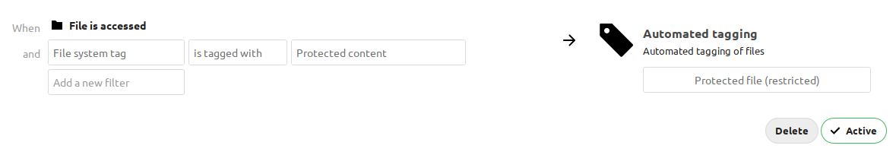
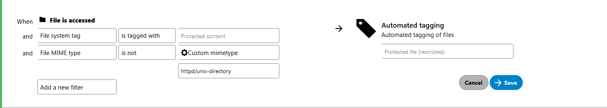

======================
Automated file tagging
======================

Nextcloud's Automated file tagging app adds the ``Tag a file`` operation to
Nextcloud Flow. It assigns collaborative tags to files and folders based on
configured conditions. These tags can be used by :doc:`retention`,
:doc:`access_control`, and other workflow apps.

How it works
------------

Each rule group contains one or more conditions combined with AND: all
conditions must match for the group to match. Every matching group assigns its
configured tag.

Rules are evaluated when eligible files or folders are inserted into or updated
in Nextcloud's file cache, not only when files are uploaded. For example, items
created directly on external storage can be evaluated when Nextcloud discovers
them.

Adding or changing a rule does not itself tag existing files. Assigning a tag to
a folder does not trigger a recursive evaluation of its existing contents.
Tags assigned by a rule are not automatically removed when the rule stops
matching or is deleted.

Configuration
-------------

Install and enable the Automated file tagging app as described in
:doc:`../apps_management`, then open
:menuselection:`Administration settings --> Flow` and select the ``Tag a file``
operation.

Users can also create personal flows when user flows are enabled; see
:doc:`configuration`. Non-admin users can select only visible, user-assignable
tags as the tags to assign. Administrators can also select restricted and
invisible tags.

Assigning restricted and invisible tags
---------------------------------------

Restricted tags are visible to regular users but cannot be assigned or removed
by them. Invisible tags are also hidden from regular users. Administrators can
manage both types.

Use these tag types for retention and access control so that regular users cannot
disable a policy by removing its tag. If tagging depends on another tag, protect
that condition tag too: removing it can prevent future items from matching.
Automatic tagging assigns tags; the retention and access-control policies must
be configured separately.

Example
-------

To tag files inside a folder marked with ``Protected content``:

1. As an administrator, create restricted tags named ``Protected content`` and
   ``Protected file``, and assign ``Protected content`` to the source folder.
2. In Flow, add a ``Tag a file`` operation with a collaborative-tag condition
   matching ``Protected content``.
3. Select ``Protected file`` as the tag to assign and save the flow.

When an eligible item is evaluated, the collaborative-tag condition checks both
the item itself and its parent folders. Matching items receive
``Protected file``, including items in nested subfolders.

The source folder and subfolders can also match when they are evaluated. To
assign the output tag only to files, add a ``File MIME type`` condition with
operator ``is not`` and value ``httpd/unix-directory``. This does not remove tags
already assigned to folders.

Available rules
---------------

See :ref:`available-rules-label` for the shared workflow conditions.

Keep the evaluation context in mind:

* **File size** uses upload request headers, not the size stored in the file
  cache. Do not rely on it for background scans or other non-upload operations.
* **User group membership** checks the currently authenticated user, not the
  file owner. Without an authenticated user, ``is`` does not match and ``is not``
  matches.
* Request-based conditions describe the request that triggers evaluation, not
  necessarily the request that originally uploaded the file. Background
  processing may not have the same request context.

.. note::
    Do not rely on automatic tagging to initialize the root folders of external
    storage mounts or group folders. Eligibility depends on the storage and
    mount path. Assign any required initial tags manually. Items inside these
    folders are evaluated on eligible file-cache insertions and updates.

Using tags with other actions
-----------------------------

This app only assigns tags. Other apps can use those tags to select files
for their own policies or actions. Each app must be installed and configured
separately.

For example:

* :doc:`retention` can automatically delete tagged files after a configured age.
* :doc:`access_control` can restrict access to tagged files.
* The `PDF Converter app
  <https://github.com/nextcloud/workflow_pdf_converter#readme>`_ can convert
  supported documents to PDF when a tag is assigned and its configured
  conditions match. It requires LibreOffice on the server.

Refer to each app's documentation for requirements and configuration details.

.. tip::

    Nextcloud GmbH provides customers with hands-on help and related
    documentation through the `customer portal <https://portal.nextcloud.com>`_.

