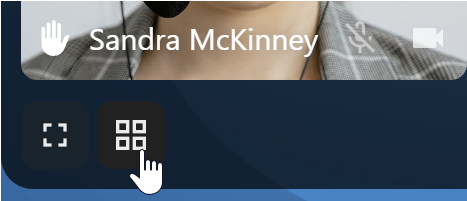
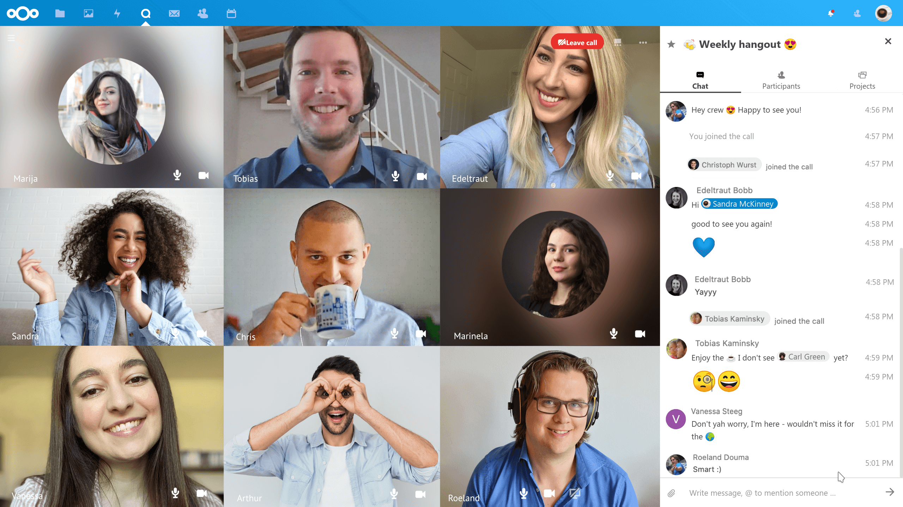

===========
Call layout
===========

You can switch between ``Grid view``, ``Speaker view`` and ``Multi-speaker view`` using the layout menu in the
bottom bar. Talk remembers your choice for each conversation.

.. TODO: update screenshot to show the layout menu with grid, speaker and multi-speaker view

Grid view
---------

Grid view shows all participants as tiles. Use the navigation buttons on the left and right to scroll through participants when they do not all fit on the screen.

Speaker view
-------------

Speaker view (also called promoted view) centres the active speaker in a large tile and places the other participants in a row below.
Use the navigation buttons on the left and right to scroll through participants when the row overflows.

Multi-speaker view
-------------------

Multi-speaker view works like speaker view, but shows up to three active speakers in large tiles instead of just
one, so you can follow a discussion between several people at once. A participant moves to a large tile after
speaking for a few seconds, and goes back to the row after about 30 seconds of silence.

Multi-speaker view is not available when the call is shown in the sidebar.

.. TODO: feature is live in 25.0.0, mock screenshot below needs to be replaced with a real capture

