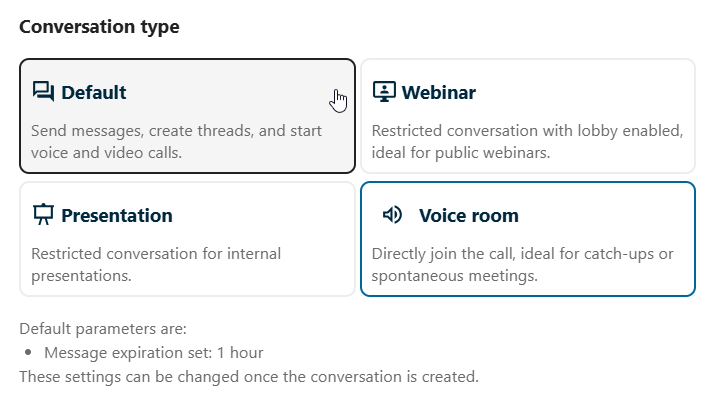

.. SPDX-FileCopyrightText: 2026 Nextcloud GmbH and Nextcloud contributors
.. SPDX-License-Identifier: CC-BY-4.0

======================
Conversation presets
======================

Conversation presets allow administrators to define templates for new conversations, with pre-configured settings such as permissions, lobby rules, and conversation type.

Available presets
-----------------

Depending on your instance configuration, you may see presets when creating a new conversation.
Each preset applies a specific set of defaults suited to a particular use case.

.. TODO: update screenshot to show the Conversation type field with the classified, channel and announcement presets

Voice room
----------

A permanent call room ("Voice room") is a conversation preset optimized for non-obligatory, always-available meetings.
Any person entering the conversation will be joining the call there, making it easier to start communicating.
Messages in voice room conversation are set to expire after certain time, to keep it lightweight and spontaneous.

Webinar
-------

Moderators can configure a preset to force the lobby, ensuring participants wait for a moderator before joining.
When a conversation uses a forced lobby preset:

- Participants see a waiting room upon joining
- A moderator must allow them to the conversation or lift the lobby
- Useful for webinars, interviews, or controlled meetings

Presentation
------------

Presentation preset is useful for internal meetings, where it is expected to have more listeners than speakers.
Participant permissions are optimized to ensure the best performance and moderation experience, allowing presenters to speak uninterrupted.

Classified conversation
------------------------

A locked-down conversation preset for confidential topics. A classified conversation cannot be made public or open
to other users on the server, so there is no public link and no guest access. Federation, SIP dial-in and dial-out,
invitations by email or phone, call recording, live transcription, bots, bridges, breakout rooms and AI summaries
are disabled. Messages expire after one hour by default.

The conversation is always marked as sensitive: notifications and activities show ``Private conversation`` instead
of its name and do not reveal message content. Message translation and private replies from other conversations are
not available.

After a call ends, the whole conversation is deleted for everyone after a period of inactivity (one hour by default).
A notice in the chat shows when the deletion happens. Moderators can click ``Delete now`` to delete it immediately,
or ``Keep`` to keep the conversation.

.. TODO: feature is live in 25.0.0, mock screenshot below needs to be replaced with a real capture

Channel
-------

A broadcast conversation preset for a large audience. Only moderators can post messages; everyone else can only
react, unless a moderator grants individual participants more permissions. Calls are disabled for everyone, including
moderators. The conversation is visible to and can be joined by other users on the server. Only moderators can see
the participant list and system messages.

.. TODO: feature is live in 25.0.0, mock screenshot below needs to be replaced with a real capture

Announcement
------------

An announcement preset works like a channel, with the same posting and call restrictions, but the conversation is
not open for other users to join, and participants who are added to it cannot leave. Participants get a notification
for every message by default, and they can change this in the notification settings.

.. note:: Only administrators can create announcements.

.. TODO: feature is live in 25.0.0, mock screenshot below needs to be replaced with a real capture

See also:

- :doc:`conversations`
- :doc:`webinar`
- :doc:`open_conversations`
